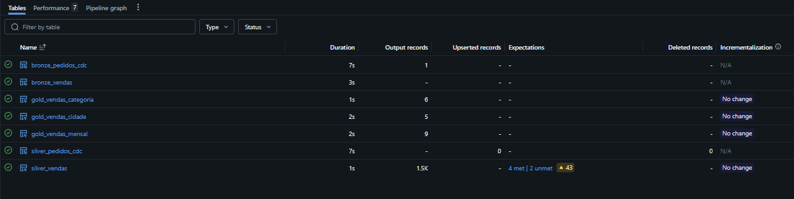
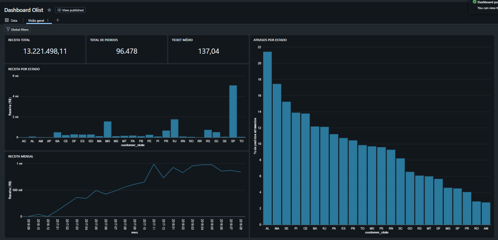

# Databricks na prática: pipeline Medallion, Auto Loader, Lakeflow e Genie

Projeto de estudo construído passo a passo na **Databricks Free Edition**. Parte de um pipeline de vendas simulado e termina em um pipeline com dados reais (Olist), cobrindo ingestão, qualidade de dados, orquestração, dashboards e consulta em linguagem natural.

## O que foi construído

| Bloco | O que foi feito | Conceitos |
|---|---|---|
| 1. Pipeline base | CSV simulado → Bronze → Silver → Gold, dashboard e Job agendado | Delta Lake, Unity Catalog, Volumes, Jobs, AI/BI Dashboards |
| 2. Delta Lake | Histórico de versões, time travel e `RESTORE` | `DESCRIBE HISTORY`, `VERSION AS OF`, `RESTORE` |
| 3. Auto Loader | Ingestão incremental de arquivos, schema evolution | `cloudFiles`, checkpoints, `availableNow`, `_rescued_data` |
| 4. Lakeflow Declarative Pipelines | Mesma cadeia em formato declarativo, com regras de qualidade | streaming tables, materialized views, expectations |
| 5. MERGE e AUTO CDC | Upsert manual e upsert declarativo com chegada fora de ordem | `MERGE INTO`, `create_auto_cdc_flow`, `sequence_by` |
| 6. Genie | Space com instruções de negócio e testes dos limites | Genie spaces, instruções, validação do SQL gerado |
| 7. Olist (dados reais) | Pipeline com 6 tabelas, joins, expectations, Gold, dashboard e Genie | Medallion com dados reais |

## Projeto principal: Olist

Dataset público [Brazilian E-Commerce by Olist](https://www.kaggle.com/datasets/olistbr/brazilian-ecommerce) (Kaggle).

**Arquitetura**

```
CSVs (Volume) → Bronze (6 tabelas) → Silver (5 tabelas) → Gold (4 tabelas) → Dashboard / Genie
```

- **Bronze:** uma tabela por arquivo, tudo como `string`, com metadados de ingestão.
- **Silver:** tipagem, deduplicação e regras de qualidade (`expect`, `expect_or_drop`).
- **Gold:** receita por mês, categoria e estado, e atraso de entrega por estado.

**Decisões de negócio (documentadas no código)**
- Receita considera apenas pedidos `delivered`, soma `price` dos itens e exclui frete.
- Atraso = data real de entrega menos data estimada, apenas para entregues com data.
- Categoria em inglês, com o nome em português como reserva e `sem_categoria` para produtos sem categoria.

**Resultados conferidos por reconciliação** (controle direto vs. cada Gold)



| Métrica | Valor |
|---|---|
| Pedidos entregues | 96.478 |
| Itens | 110.197 |
| Receita | R$ 13.221.498,11 |
| Ticket médio | R$ 137,04 |
| Pedidos entregues com atraso | 6.534 de 96.470 (6,77%) |

Os 96.470 excluem 8 pedidos marcados como `delivered` sem data de entrega, uma inconsistência real do dado, medida por uma expectation.



**Armadilhas tratadas**
- Um pedido tem vários itens e pagamentos: manter uma tabela por grão evita inflar a receita em joins.
- Na Gold por categoria, a soma de `pedidos` passa do total (97.276 vs. 96.478), porque um pedido pode ter itens de categorias diferentes. A reconciliação usa itens e receita.
- Ranking de percentual de atraso só considera estados com 100 ou mais pedidos entregues, para evitar distorção por amostra pequena.

## Projeto de vendas simulado

CSV gerado por código, com sujeira proposital (categorias vazias, quantidades nulas e duplicatas), usado para exercitar cada recurso:

- **Auto Loader:** 5 lotes de arquivos, só o arquivo novo é lido a cada execução. Um lote com coluna nova (`canal_venda`) faz o stream falhar de propósito na primeira execução e funcionar na segunda.
- **MERGE vs. dropDuplicates:** com correções de pedidos já existentes, `dropDuplicates` manteve as versões antigas em silêncio, e o `MERGE` aplicou as novas.
- **AUTO CDC:** uma versão antiga de um pedido, chegando depois da correção, foi ignorada graças ao `sequence_by`.

> Os schemas deste projeto foram removidos do workspace depois dos estudos. O código está nos notebooks e os dados podem ser regerados.

## Estrutura do repositório

```
.
├── README.md
├── 01-vendas-simulado/
│   ├── projeto-vendas-01-intro
│   ├── projeto-vendas-02-ingestao
│   ├── projeto-vendas-03-silver
│   ├── projeto-vendas-04-gold
│   ├── projeto-vendas-05-delta
│   └── job-01-bronze, job-02-silver, job-03-gold
├── 02-auto-loader/
│   ├── autoloader-01-landing
│   ├── autoloader-02-ingestao
│   └── job-04-bronze-incremental, job-05-silver-incremental
├── 03-lakeflow/
│   └── pipeline-vendas-lakeflow/my_transformation.py
├── 04-merge-e-cdc/
│   ├── merge-01-upsert
│   └── cdc-01-fonte
├── 05-olist/
│   ├── olist-01-inspecao
│   └── pipeline-olist/my_transformation.py
└── docs/img/            # prints do dashboard e do grafo do pipeline
```

## Como reproduzir

1. Crie uma conta na **Databricks Free Edition**.
2. Baixe o dataset da Olist no Kaggle (os CSVs **não** estão neste repositório, por causa da licença e do tamanho).
3. Crie o schema e o volume, e envie os CSVs:
   ```sql
   CREATE SCHEMA IF NOT EXISTS workspace.olist;
   CREATE VOLUME IF NOT EXISTS workspace.olist.raw;
   ```
4. Importe os notebooks e crie um pipeline ETL (catálogo `workspace`, schema `olist`) com o arquivo `05-olist/pipeline-olist/my_transformation.py`.
5. Execute o pipeline e crie o dashboard e o Genie space sobre as tabelas Gold.

## Observações

- A Free Edition usa compute serverless e tem cota limitada. A primeira execução de um Job ou pipeline pode levar vários minutos por causa do início a frio, e as seguintes são bem mais rápidas.
- Os nomes de botões e de APIs (`dp.materialized_view`, `dp.create_auto_cdc_flow`) mudam entre versões. O código foi validado na versão disponível em outubro de 2026.

## Créditos

Dataset: Olist, disponível no Kaggle sob licença CC BY-NC-SA 4.0. Projeto desenvolvido para fins de estudo.
